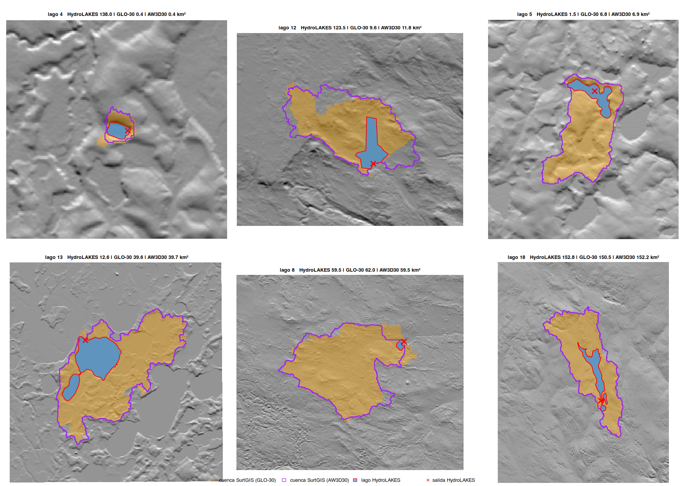

# Cuencas de lagos en permafrost con SurtGIS: respuesta al brief del paper ártico

**Fecha**: 2026-11-05
**Pedido**: brief "delimitación masiva de cuencas de lagos en terreno de permafrost" (proyecto smelt, paper de química de lagos árticos).
**Base**: SurtGIS 1.7.0 + PR #151; prototipo y resultados crudos en `~/proyectos/smelt/artic/results/lake_catchments_surtgis/`.

**Leyenda**: *verificado* = medido o comprobado en esta sesión; *inferido* = juicio razonado, con su confianza; *supuesto* = no comprobado.

---

## 1. Conclusión

SurtGIS puede reemplazar a HydroLAKES para esta muestra, con una condición: los lagos deben entrar como polígonos, no solo como coordenadas. El criterio del brief ("área de cuenca dentro de un 20 % de HydroLAKES en la mayoría") **no se cumple** (6 de 20), pero ese criterio no sirve para decidir. Al norte de 60°N, HydroLAKES calcula las cuencas con la red de HydroSHEDS v1, que ahí sale del DEM HYDRO1k de 1 km (verificado en las dos documentaciones técnicas).

Hay tres argumentos para preferir SurtGIS:

1. **Cobertura.** Solo el 20 % de las 1.539 ubicaciones de la muestra cae dentro de un lago de HydroLAKES (verificado). HydroLAKES deja sin atributos a la mayoría de los sitios.
2. **Robustez.** Con el mismo polígono de lago, SurtGIS sobre dos DEM independientes (Copernicus GLO-30 y ALOS AW3D30) da cuencas que coinciden dentro del 20 % en 10 de 20 lagos, con mediana de razón 1,00 (verificado). En 7 de esos 10, HydroLAKES discrepa de ambos.
3. **Inspección visual.** En los lagos donde HydroLAKES y SurtGIS más difieren, las cuencas de SurtGIS siguen las divisorias del relieve; las de HydroLAKES no son compatibles con el relieve a 30 m (inferido, muy probable; figura en la sección 3).

Falta construir el módulo: hoy es un prototipo de unas 250 líneas sobre funciones existentes. El diseño mínimo y el esfuerzo están en la sección 5: alrededor de 3 a 4 semanas.

---

## 2. Los puntos 1 a 5 del brief

| Punto | ¿Se puede hoy? | Cómo, o qué falta |
|---|---|---|
| 1. Los lagos son las depresiones | **Sí**, con un cambio de orden | Definir el lago **antes** de rellenar y pasar **todas sus celdas** como puntos de salida a `watershed`; luego `priority_flood` y D8 sobre el resto. El relleno ya no borra el lago, porque el lago es la salida. `nested_depressions` no hace falta para esto: sirve para jerarquías de depresiones, no para separar un lago conocido. |
| 2. La salida no es un píxel | **Parcial** | `watershed` acepta una lista de píxeles, y basta pasarle el lago completo (verificado). Falta: rasterizar un polígono de lago sobre la grilla del DEM como conjunto de salida, y la detección automática desde una máscara de agua cuando no hay polígono. |
| 3. Escala continental | **Sí, por ventanas** | El prototipo baja Copernicus GLO-30 por STAC solo alrededor de cada lago, reproyecta a UTM y agranda la ventana (16 → 32 → 64 → 128 km) mientras la cuenca o el lago toquen el borde. Falta el orquestador dentro de SurtGIS; hoy lo hace un script. |
| 4. Muchos lagos por corrida | **No** | Falta el modo batch: paralelismo por lago, reintentos y salida tabular. |
| 5. Tiempo de residencia | **Parcial** | La acumulación ponderada existe desde 1.6.0 (`hydrology flow-accumulation --weights`), pero con la cuenca ya delimitada basta el caudal medio = escorrentía media de la cuenca × área. Falta el volumen: no hay un modelo de profundidad de lago en SurtGIS. |

**Medición del prototipo (verificado)**: mediana de 9 s por lago con GLO-30. Una ventana de 16 km bastó en 15 de 20 lagos; un lago necesitó 128 km. Para unos 2.300 lagos y 8 en paralelo, el costo sería del orden de una hora (inferido, probable; domina la descarga).

---

## 3. Benchmark: 20 lagos contra HydroLAKES

### Método

1. **Cruce.** Las 2.849 filas de la muestra (1.539 ubicaciones únicas, EPSG:3995) se cruzaron con los 765.442 polígonos de HydroLAKES al norte de 59°N.
2. **Selección.** 20 lagos estratificados por área (de 0,13 a 38 km²) y sector de longitud: Alaska, Canadá, Groenlandia y Siberia.
3. **Delimitación.** DEM por STAC de Planetary Computer, reproyectado a UTM con vecino más cercano y 30 m. Lago como conjunto de salida, priority-flood (ε = 1e-4), D8 y `watershed`.
4. **Dos variantes de lago:**
   - **A**: el lago se detecta desde ESA WorldCover 2021 (clase 80), la componente conectada más cercana a la coordenada.
   - **B**: el lago es el polígono de HydroLAKES rasterizado. Así se compara solo la cuenca, con el mismo lago en ambos lados.
5. **Segunda opinión.** La variante B se repitió con ALOS AW3D30.

### Cobertura de HydroLAKES sobre la muestra (verificado)

| Distancia al lago de HydroLAKES más cercano | Ubicaciones | % |
|---|---|---|
| Dentro del polígono | 308 | 20,0 |
| A 250 m o menos | 507 | 32,9 |
| A 1 km o menos | 843 | 54,8 |
| Sin lago de HydroLAKES a menos de unos 2 km | 395 | 25,7 |

### Área del lago (variante A, WorldCover)

Con la apertura morfológica final, la razón SurtGIS/HydroLAKES tiene mediana 1,07: 9 de 18 lagos dentro del 20 % y 14 de 18 dentro del 50 %. Dos teselas de WorldCover no se pudieron bajar de Planetary Computer.

La detección automática es la parte frágil. WorldCover une lagos con ríos anchos: el lago 2 salió con 268 km² de cuenca antes de la apertura. La apertura corta esos ríos, pero parte lagos de forma estrecha: el lago 18 bajó de 15,4 a 1,0 km² de espejo. **Inferido (muy probable)**: el módulo debe recibir polígonos de lagos (HydroLAKES donde existan; una máscara propia u otro inventario donde no) y dejar la detección automática como respaldo con advertencia.

### Área de cuenca (variante B, mismo lago)

| Comparación | Dentro del 20 % | Dentro del 50 % | Mediana de la razón |
|---|---|---|---|
| GLO-30 contra HydroLAKES | 6/20 | 6/20 | 1,11 |
| AW3D30 contra HydroLAKES | 6/20 | 8/20 | — |
| AW3D30 contra GLO-30 | **10/20** | **15/20** | **1,00** |

Por lago (km²):

| Lago | HydroLAKES | GLO-30 | AW3D30 | Lectura |
|---|---|---|---|---|
| 1 | 1,2 | 2,7 | 140,9 | DEM discrepan (fuga en AW3D30) |
| 2 | 0,5 | 0,9 | 0,6 | cuenca diminuta |
| 3 | 48,3 | 4,1 | 0,3 | terreno termokárstico plano; DEM discrepan |
| 4 | 138,0 | 0,4 | 0,4 | DEM coinciden; HydroLAKES no |
| 5 | 1,5 | 6,8 | 6,9 | DEM coinciden; HydroLAKES no |
| 6 | 3,2 | 15,3 | 14,7 | DEM coinciden; HydroLAKES no |
| 7 | 1,0 | 1,9 | 1,7 | DEM coinciden; HydroLAKES no |
| 8 | 59,5 | 62,0 | 59,5 | **los tres coinciden** |
| 9 | 3,4 | 3,0 | 3,7 | razonable |
| 10 | 12,7 | 6,3 | 5,3 | DEM coinciden; HydroLAKES no |
| 11 | 10,6 | 5,0 | 26,2 | DEM discrepan |
| 12 | 123,5 | 9,6 | 11,8 | DEM casi coinciden; HydroLAKES no |
| 13 | 12,6 | 39,6 | 39,7 | DEM coinciden; incluye un lago aguas arriba |
| 14 | 33,7 | 29,5 | 40,2 | razonable |
| 15 | 11,7 | 22,1 | 7,2 | DEM discrepan |
| 16 | 56,6 | 62,8 | 70,4 | **coinciden** |
| 17 | 1.197,5 | 1.924,6 | 1.140,1 | cuenca grande, DEM discrepan |
| 18 | 152,8 | 150,5 | 152,2 | **los tres coinciden** |
| 19 | 35,1 | 30,6 | 54,0 | DEM discrepan |
| 20 | 57,6 | 109,5 | 111,9 | DEM coinciden; HydroLAKES no |

*Cuenca GLO-30 en naranja, contorno de la cuenca AW3D30 en morado, lago de HydroLAKES en azul con borde rojo, punto de salida de HydroLAKES con una cruz.*

### Interpretación

- **Verificado**: al norte de 60°N, HydroSHEDS v1 usó el DEM HYDRO1k de 1 km remuestreado a 15 segundos de arco (HydroSHEDS TechDoc, sec. 2.7 y 3.7), y `Wshd_area` de HydroLAKES sale de esa red (HydroLAKES TechDoc). Los polígonos de lagos de Rusia al norte de 60°N vienen de MODIS a 250 m.
- **Inferido (muy probable)**: con celdas de 1 km, HydroLAKES no puede resolver cuencas de pocos km², y amarra algunos puntos de salida a drenes mayores. Los casos 4 y 12 de la figura lo muestran: dos DEM a 30 m dibujan la misma cuenca local, y HydroLAKES reporta 10 a 300 veces más.
- **Inferido (probable)**: los desacuerdos entre GLO-30 y AW3D30 se concentran en terreno plano de termokarst (lagos 1, 3, 11, 15, 19), donde la red de drenaje depende de decímetros. Ahí la cuenca es incierta con cualquier DEM. El módulo debería reportarlo: correr dos DEM y marcar el lago cuando difieran más de un umbral.
- **Supuesto**: que una referencia independiente de alta resolución confirmaría la lectura anterior. No se probó. El siguiente paso de validación sería comparar con MERIT-Hydro (90 m, global; requiere registro) o con NHDPlus HR en Alaska.

---

## 4. Qué DEM usar

| DEM | Uso recomendado | Por qué |
|---|---|---|
| **Copernicus GLO-30** | **Principal para cuencas** | Cobertura completa hasta los polos, sin fallas de teselas en esta prueba, en Planetary Computer con STAC. Ojo: **no aplana los lagos pequeños** (verificado en el lago 6: superficie de agua con ruido de ±0,5 m), así que no sirve para detectar lagos desde el DEM. |
| **ALOS AW3D30** | **Segundo DEM para medir la incertidumbre** | Independiente de GLO-30 y en el mismo catálogo. Es un modelo de superficie (incluye vegetación). Con 1.7.0 SurtGIS no lo podía leer; queda arreglado con el PR #151. |
| **FABDEM V1-2** | **Mejor que GLO-30 bajo bosque; igual en tundra** | Es GLO-30 con bosques y edificios removidos por random forest (Hawker et al. 2022; V1-2 corrige la alineación de teselas sobre 50°N). En taiga, el dosel crea falsas divisorias y depresiones que desvían el drenaje; FABDEM las quita. En tundra no hay dosel que quitar y queda prácticamente igual a GLO-30 (inferido). Límites: cobertura documentada hasta 80°N, y 46 de las 1.539 ubicaciones de la muestra están más al norte (verificado); no está en un catálogo STAC con búsqueda, se baja de data.bris en teselas COG; licencia no comercial (CC BY-NC-SA 4.0 según mirrors; el registro de data.bris no se pudo leer), suficiente para un paper. No se probó en este benchmark. |
| **ArcticDEM** | **Solo para la ribera o una ventana puntual** | A 2 m capta la ribera y sirve para estimar profundidad con la pendiente de orilla. Tiene huecos y artefactos sobre agua, y PGC lo publica como catálogo STAC estático (`arcticdem.json`), que el cliente STAC de SurtGIS todavía no recorre: hoy solo usa APIs con `/search`. Los mosaicos de 10 y 32 m podrían servir para cuencas; no se probaron. |

La intuición del brief se sostiene: GLO-30 para cuencas y ArcticDEM solo si hace falta la ribera. Agrego usar AW3D30 como segunda opinión, y FABDEM en lugar de GLO-30 en la franja boreal (715 de las 1.539 ubicaciones están entre 60 y 66,5°N), con GLO-30 como respaldo sobre 80°N.

---

## 5. Diseño mínimo: `surtgis hydrology lake-catchment`

**Entrada**
- `--lakes`: polígonos (GPKG, GeoParquet o Shapefile) **o** puntos con `--water-mask worldcover` como respaldo.
- `--dem`: un archivo local, o `--dem-stac pc:cop-dem-glo-30` (repetible, por ejemplo `--dem-stac pc:alos-dem` para el ensamble).
- `--window-km 16 --max-window-km 256`, `--jobs N`, `--retries 3`.
- `--runoff <raster>` opcional, por ejemplo P − ET anual de ERA5-Land, para el caudal.

**Salida**: GeoParquet o CSV con una fila por lago:
- `lake_id`, `lake_area_km2`, `lake_perimeter_km`, `lake_elev_m`;
- `catchment_area_km2`, `catchment_to_lake_ratio`, `catchment_mean_elev_m`;
- `window_km`, `dem`, `status` (`ok`, `edge`, `lake_split`, `error: …`);
- con dos DEM, `catchment_spread` = máx/mín entre DEM;
- con `--runoff`, `q_mean_m3s` y, si hay volumen, `residence_days`.

Los polígonos de cuenca van opcionalmente en un GPKG. Cada salida lleva la provenance con los ítems STAC leídos, desde 1.7.0.

**Piezas**

| Pieza | Estado | Esfuerzo |
|---|---|---|
| `hydrology::lake_catchment(dem, lake_mask)` en la librería: lago como salida, relleno, D8 y unión de cuencas | prototipo listo | 2–3 días con tests |
| Polígono → conjunto de salida sobre la grilla del DEM; detección desde máscara de agua con apertura y aviso de lago partido o unido a río | prototipo listo | 2–3 días |
| Orquestador: ventana STAC por lago, reproyección a UTM, ampliación adaptativa, ensamble de DEM, paralelismo, reintentos, tabla de salida | script en Python | 1 semana |
| Caudal: zonal de escorrentía sobre la cuenca | piezas existentes | 1–2 días |
| Volumen y residencia: profundidad desde la pendiente de ribera (Hollister y Milstead 2010) y volumen cónico; validar contra `Vol_total` de HydroLAKES en lagos grandes | no existe | 1 semana |
| Docs, ejemplo y CLI | — | 2–3 días |

**Total: unas 3 a 4 semanas** (inferido). Sin la parte de volumen y residencia, unas 2 semanas.

**Riesgos**
- La detección automática del lago (une o parte lagos) es el punto débil si no hay polígonos.
- El terreno plano de termokarst hace inestable la cuenca con cualquier DEM.
- Las teselas de WorldCover fallan a veces en Planetary Computer.

---

## 6. Hallazgos colaterales

- **SurtGIS no leía ALOS AW3D30 de Planetary Computer** (ninguna tesela): el lector LZW rechazaba streams que codifican más de lo que cabe en la tesela. Arreglado en el PR #151, verificado idéntico a GDAL en 78.554 celdas.
- **El cliente STAC no recorre catálogos estáticos** (ArcticDEM, REMA, EarthDEM de PGC): es un hueco para el diseño anterior.

---

## 7. Límites

- 20 lagos es una muestra pequeña; la estratificación por tamaño deja 4 lagos por clase.
- No hay una referencia de alta resolución independiente; la comparación entre dos DEM mide robustez, no exactitud.
- Las áreas se calculan en UTM a 30 m (error de escala menor a 0,2 %).
- La variante A depende de WorldCover 2021; la variante B, del polígono de HydroLAKES.
